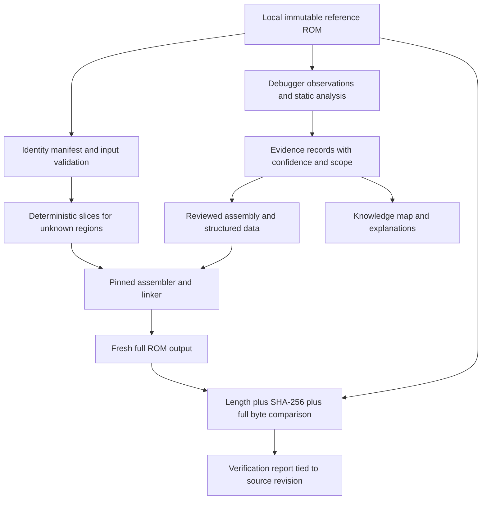

# Technical architecture

Status: written 2026-09-12 as a proposal; the binary identity and confidence requirements are mandatory. Updated 2026-10-17: the matching build exists, and the repository layout below is the one in use. The tool-choice and gate sections are the original design; the gate is implemented by `tools/build.py` and `tools/verify_rom.py`.

## Product and organizing principle

The primary product is a matching disassembly of one identified Cobi's Journey ROM, accompanied by explanations of its systems and evidence that supports them. Assembly instructions and structured data progressively replace opaque byte ranges. Pseudocode helps explain behavior but is not the canonical build input.

Organize the initial source by physical ROM bank and address, because those remain stable while our understanding changes. Add semantic indexes and subsystem documents over that layout. Move source into larger engine modules only when symbol coverage and the linker can preserve placement exactly.

Unknown bytes remain explicit. A routine may have completely verified instruction bytes and C0 purpose. A data table may round-trip perfectly while some fields remain C1. Neither condition is a failure of the method.

## Data flow and trust boundaries



The reference feeds only declared opaque slices and the independent verifier. The build must never overwrite assembled regions from the reference to conceal mismatches. The verifier compares original files without normalizing either side.

## Repository layout

```text
README.md, AGENTS.md            entry points and operating contract
docs/                          system documentation, evidence log, status and roadmap
config/targets/                edition/revision/hash manifests
config/toolchain.lock.json     exact tested RGBDS release and its hashes
config/*.json                  what the generator reads: names.json, annotations.json, tables.json,
                               symbols.json, code_entries.json, operands.json, banks.json, ... (being
                               retired from the workflow, D-015 and docs/GRADUATION.md)
config/probes/                 emulator probes for routine notes (tools/probe.py)
src/                           the source: edit it directly (D-015). tools/disasm_all.py writes its
                               own tree to build/regen/src/; tools/src_drift.py compares the two
src/main.asm                   the include list
src/layout.link                places every floating section in its bank (rgblink -l)
src/<dir>/bankNN_<topic>.asm   one ROM bank each, in a directory by kind (D-010): home, engine,
                               scripts, text, data, maps, gfx, audio, unused
src/ram.asm, src/*.inc         RAM names, record fields, constants, macros, charmap, hardware registers
src/assets.txt                 the asset files src/ includes, with their place in the reference ROM
tools/                         generator, build and verifier, emulator (sm83.py), LZSS decoder and encoder,
                               asset export, probes, shift test, checks of mechanics and tables, the data
                               tables as files (datatables.py), renames (rename.py), src/ helpers (source_tree.py)
tests/                         verifier negative cases, generator and source checks, emulator probes
local/roms/                    ignored: the immutable reference ROM; local/assets etc. for exports
build/                         ignored, disposable: runN/ build reports, listing/ (annotated listing)
```

Game data never enters git: assets are extracted from the local reference at build time, and exports of decoded
assets or tables go under `local/` or `build/` (the tools refuse other paths).

## Tool choices

| Role | Recommendation | Rationale and qualification |
| --- | --- | --- |
| Assembly/link | RGBDS | Game Boy assembly toolchain used by surveyed projects; pin the exact release after a successful fixture/build. [Upstream](https://github.com/gbdev/rgbds) |
| Small orchestration and analysis tools | Python 3 standard library where practical, with a PowerShell entry point if useful | Proposed portable hashing, binary parsing, subprocess/error handling, and JSON reports; select and record the tested version |
| Interactive debugging on Windows | BGB | Supports symbols, access watchpoints, tracing, and reverse stepping. Verify the selected version with our target. [BGB features](https://bgb.bircd.org/) |
| Independent runtime cross-check | SameBoy | Separate emulator implementation with debugging support; compare difficult hardware/timing observations. [SameBoy](https://sameboy.github.io/) |
| Hardware and opcode reference | Pan Docs and RGBDS instruction reference | Use their actual register and instruction definitions; DWM-specific behavior still needs local evidence. [Pan Docs source](https://github.com/gbdev/pandocs), [instruction reference](https://github.com/gbdev/rgbds/blob/master/man/gbz80.7) |
| Evidence storage | Markdown plus small JSON manifests | Easy to review and retain in Git; a database is unnecessary at this stage |

Do not assume installed tools or choose a floating `latest` build dependency. A native Windows build is the first candidate; evaluate WSL/MSYS2 only if historical dependencies justify it. Record shell, OS, versions, executable/package hashes, flags, environment assumptions, and working directory. Do not import upstream push/commit wrappers into our build.

## Target manifest contract

One manifest describes one exact reference, provisionally named `dwm2-cobi-us-<revision>` once identified. Required fields:

- Stable target ID; game, platform, region/language, revision and identification provenance.
- Exact byte count and full SHA-256. Optional SHA-1/CRC32 only for comparison with historical catalogs.
- Observed header bytes and interpreted cartridge type, ROM/RAM sizes, CGB/SGB flags, and revision byte. Header checksum validity is recorded separately from file identity.
- Mapping assumptions validated against that header and code; a filename alone supplies none of these facts.
- A configurable local input path, toolchain-lock reference, and expected output identity. Machine-specific absolute paths belong in local configuration, not shared manifests.

The input hash is measured first and compared with independent edition/revision evidence where available. Hashing a file identifies it but does not, by itself, establish that it is an unmodified retail revision. Do not invent a canonical Cobi hash from a DWM1 checksum or an upstream output-size statistic.

## Mandatory binary identity gate

1. Validate that the reference exists, its size and hash match the approved manifest, and the input and output are different paths. A mismatch fails before extraction.
2. Start with an empty, task-specific output directory. Resolve cleanup paths beneath `build/`; never use a mirror/delete operation against an unchecked path. Record the exact source tree and inputs.
3. Extract declared slices reproducibly, then assemble and link at explicit banks and addresses. Capture maps, symbols, exit codes, and logs. Stop on any tool failure; stale output cannot count.
4. Preserve the entire header and padding. If a post-processing step is necessary, pin its flags and explain every resulting byte. Do not routinely run `rgbfix` with guessed defaults.
5. Require **equal file length**, **equal approved SHA-256**, and **zero differences in a complete byte comparison**. Include every bank, the header, unused space, and final padding. A checksum field, boot smoke test, or percentage is insufficient.
6. Emit a report with target ID, reference/output sizes and hashes, source revision and dirty-tree digest, toolchain versions/hashes, flags, pass/fail, total differing bytes, and first mismatching offset/ranges. Map offsets to bank/CPU locations only where the mapping is established. A truncated diff display must still report the full count.
7. At initial setup, toolchain changes, and reproducibility milestones, repeat from another clean output directory and compare both outputs to the reference. For routine source changes, one clean verified build per affected target is required.

Before calling the gate reliable, test it with synthetic data: identical input, one changed interior byte, one changed header byte, shortened/extended output, missing reference, wrong reference hash, failed assembler with stale output present, and input/output path collision. A failed native command must propagate failure even if a later command succeeds.

A documentation-only change does not require inventing a ROM build. Record that it was not run. Once code exists, only a report for the exact final source tree can certify build-affecting work.

## Continuous verification

Proposed checks: reference verification; build and full comparison; section-boundary assertions; deterministic extraction; round-trip tests for changed data formats; evidence-reference and documentation checks. Meaningful behavior experiments support semantic claims separately.

If public CI lacks the reference ROM, it can run synthetic verifier/parser tests and documentation checks but must label binary identity **UNVERIFIED**. Use a controlled local/private runner for the mandatory match report, and make that report a required acceptance gate for build-affecting changes. Do not upload ROMs or embed them in public caches/artifacts. During the pre-build stage, accept planning documents only; draft source cannot claim a verified baseline.

## Address model and initial platform facts

The Game Boy CPU has a 16-bit address space. Cartridge ROM commonly appears in a lower 16 KiB window and a switchable upper 16 KiB window; CGB working RAM and video RAM also have banks. Consequently, a CPU address does not uniquely identify a ROM file position or a banked RAM variable. [Pan Docs memory map](https://github.com/gbdev/pandocs/blob/master/src/Memory_Map.md)

For a conventional 16 KiB ROM bank mapped at `$4000..$7FFF`:

```text
file_offset = bank * 0x4000 + (cpu_address - 0x4000)
example: bank 0x35, CPU 0x433B -> file offset 0xD433B
```

This is address arithmetic, not confirmation that the example contains monster data. Do not apply the formula to RAM, banked lower windows, boot-ROM overlays, or unresolved mappings. Record RAM as a space/bank/address tuple, with the execution mode and lifetime where relevant.

The DWM2 upstream script uses a cartridge-type value associated with MBC5+RAM+battery. That is **C1 for our target until the local header is checked**, not a settled hardware inventory. [Upstream script](https://github.com/NiyaDev/DWM2/blob/055ecee52ce0c9be928817c03f7dc9d37c005f03/build.bat), [Pan Docs MBC5](https://github.com/gbdev/pandocs/blob/master/src/MBC5.md)

## Game systems: investigation boundaries

Boot/reset and interrupt handling, bank transitions, memory copying, input, rendering/text, audio, game-state dispatch, monsters/progression, battle/recruitment, breeding, maps/encounters/keys, save data, and link communication are useful **research categories**. Their exact entry points, interfaces, and dependencies are C0 unless a [knowledge-map](KNOWLEDGE_MAP.md) entry explicitly identifies a C1 lead. This is not a recovered call graph.

For each established routine, document calling convention, incoming bank state, inputs, outputs, clobbered registers/flags, side effects, and known callers. For each data range, document shape, pointer encoding, units, enum holes, aliases, and consumer evidence. Preserve multiple uses of a byte range instead of forcing it into one convenient category.
