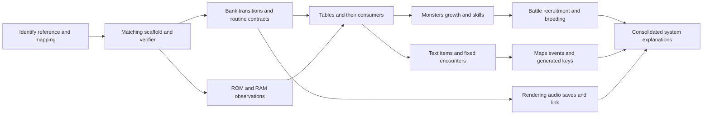

# Knowledge map

Historical planning baseline: **2026-09-12**, before local verification. Current target: **DWM2: Cobi's Journey**, `dwm2-cobi-us-rev0`; header version 0, catalog cross-check pending. Local findings are recorded in [the evidence log](EVIDENCE_LOG.md) and [current status](PROJECT_STATUS.md). The research-lead tables below retain their original confidence and are not a current coverage inventory.

## Checked systems (2026-10-17)

| System | Finding and confidence | Evidence / next action |
| --- | --- | --- |
| Join offer, level-up gains, breeding child | C2 on tools/sm83.py: specifications that agree with the game's routines on 3,000 generated states each | E-0396, [mechanics](MECHANICS.md) |
| Wild monsters per story map; breeding routes | C2 on tools/sm83.py: lists, draws (all 128 random states) and route pairings agree with the game; world grouping C1 | E-0400, [breeding paths](BREEDING_PATHS.md) |
| Damage: plain attack, resistance scaling, resolve step 7, applying it to HP, the other 28 routines | C2 on tools/sm83.py: 3,000 of 3,000 states each; routines read from src/ | E-0397, E-0399, E-0404, [mechanics](MECHANICS.md) |
| The bred child's sex, resistances, skill list and stat bonus | C2 on tools/sm83.py: 3,000 of 3,000 families | E-0405, [mechanics](MECHANICS.md) |
| Skill learning on a level-up | C2 on tools/sm83.py: 3,000 of 3,000 records; MegaMagic's own rule | E-0398, [mechanics](MECHANICS.md) |
| Species, skill and item tables | C2: layouts round-trip byte for byte; the game's loaders read the exported record for every id | E-0396, [data tables](DATA_TABLES.md) |
| Compressed assets | C2: an encoder reproduces all 3,546 LZSS streams; assets build from decoded data | E-0394, [editable assets](ASSETS.md) |
| Code and data placement | 9,071 floating sections; padded and moved builds checked on tools/sm83.py, over 222 recipe runs (2,638 routines), a key world entered at the shrine and a linked breeding; 512 fixed-bank pointers asserted at link time | E-0388 to E-0393, E-0401, E-0406, E-0410, [shiftability](SHIFTABILITY.md) |

## Readability investigations (2026-10-14, historical; the readability goal completed 2026-10-16, E-0386)

| Range / system | Finding and confidence | Evidence / next action |
| --- | --- | --- |
| Bank $12 CPU [$4001,$43DA), field command paths and their message/battle stubs | C1: 33 whole-routine explanations; twelve-stage player/follower paths, exact hop phase and eight-bit coordinate updates, party-size shortcuts. Five direct routine probes pass in the project's emulator. | [E-0358](EVIDENCE_LOG.md#e-0358--scripted-player-and-follower-paths-read-through-their-transitions), [worked reading](OBJECT_PATHS.md). Arena stages are the next row. |
| Bank $12 CPU [$43DA,$4919), arena dispatchers/stages and message table; related $0C helpers and party heal | C1: 29 whole-routine readings, shared stages and exact counter conditions, byte/nibble message lookup, individual foe-word draws and incoming SRAM-bank dependency. Eight direct routine probes pass. | [E-0359](EVIDENCE_LOG.md#e-0359--arena-scene-stages-and-their-shared-data), [worked reading](ARENA_SCENE.md). Link/breeding presentations are the next row. |
| Bank $12 CPU [$4919,$4E4B), link/breeding stages, return table and snapshot; related field dispatcher/loaders | C1: 36 whole-routine notes; conditional clipping save, exact timers, record-based graphics, distinct return contracts, corrected field-record byte return and saved-link-flag direction. Ten original-ROM probes pass. | [E-0360](EVIDENCE_LOG.md#e-0360--link-and-breeding-presentation-stages), [worked reading](LINK_BREEDING_SCENES.md). Follower movement/warp commands are the next row. |
| Bank $12 CPU [$4E4B,$4FEA), follower/player step and warp commands; related $12/$02 follower helpers | C1: 18 whole-routine notes; exact two-pixel thresholds, intermediate-boundary target snapshots, last-Y-only completion, stagger gates, action-bit wait, unsigned overshoot. Ten original-ROM probes pass; next-screen setup checks its callee input only. | [E-0361](EVIDENCE_LOG.md#e-0361--follower-command-coordinates-and-completion), [worked reading](FOLLOWER_COMMANDS.md). Sprite overrides and map-link warp are the next row. |
| Bank $12 CPU [$4FEA,$51F4), sprite flash/message and map-link warp; shared lift, $04 graphics/rendering/pose table, $0A timer and RNG | C1: 24 whole-routine notes, corrected graphics-id HRAM fields, nine structured pose regions, exact palette/turn/countdown conditions and sixteen normal-map links. Seventeen original-ROM probes pass; renderer routing is probed up to its draw callee. | [E-0362](EVIDENCE_LOG.md#e-0362--sprite-override-selection-rendering-and-map-link-warps), [worked reading](SPRITE_WARP_COMMANDS.md). Next: MapExitWarp at $12:$51F4 and ReturnWarp. |

This map connects research questions to evidence and experiments. It is not a recovered module layout or call graph. C0 means no supported local interpretation; C1 means an external lead or hypothesis; C2/C3 require local evidence under the [evidence standard](EVIDENCE_LOG.md). Source IDs resolve in [the survey](SURVEY.md).

## Research dependencies

Edges indicate a recommended investigation order, not verified runtime calls. Documentation, assembly learning, and source archaeology can continue while ROM-dependent work waits.

## Systems and first useful questions

Rows marked C1 register external leads **K-01 through K-10**. These IDs can be cited as provisional evidence references; create a full E-record before promoting a claim to C2/C3. The source link supplies provenance; the proposed experiment is not a result.

| Lead / area | Current knowledge and confidence | Entry source | First local experiment / acceptance |
| --- | --- | --- | --- |
| Foundation: identity, header, mapping | C0: no selected bytes, size, hash, or verified mapper | [Target contract](ARCHITECTURE.md) | Inspect the reference, reconcile header and file size, record identity; reject ambiguous revision claims |
| K-01: boot, interrupts, bank calls | C1: upstream routine names and hardware notes are leads | [S01 source](https://github.com/NiyaDev/DWM2/tree/055ecee52ce0c9be928817c03f7dc9d37c005f03/src) | Follow entry and one bank transition; record registers, mapping, return path, and interrupts |
| K-02: input and memory helpers | C1: upstream copy/input candidates | [S01 Bank0](https://github.com/NiyaDev/DWM2/tree/055ecee52ce0c9be928817c03f7dc9d37c005f03/src/Bank0) | Explain one short routine; distinguish copying, filling, and caller purpose with a trace |
| K-03: species, IDs, and core records | C1: candidate pointer lookup and fixed records | [S08](https://dragon-warrior-monsters-2-modding.fandom.com/wiki/Core_monster_data); E-0003 | Validate pointer targets and bounds; trace a reader; test a normal and unused ID before defining enum/record relationships |
| K-04: growth, experience, skills, items | C1: external table-location claims | [S07](https://dragon-warrior-monsters-2-modding.fandom.com/wiki/ROM_Map), [S05](https://github.com/TheCowness/DWM2Randomizer) | Decode one bounded table and trace a lookup; preserve unknown fields and reproduce exact bytes |
| K-05: battle state and HP | C1: RAM-map candidates | [S09](https://datacrystal.tcrf.net/w/index.php?title=Dragon_Warrior_Monsters_2/RAM_map&oldid=59319); E-0004 | Watch damage/healing in a known bank and mode; establish whether the field is transient or persistent |
| K-06: breeding and resistance inheritance | C1: firsthand guide and table hypotheses | [S11](https://gamefaqs.gamespot.com/gbc/525414-dragon-warrior-monsters-2-cobis-journey/faqs/62849), [S13](https://dragon-warrior-monsters-2-modding.fandom.com/wiki/Breeding_data) | Separate species selection from inherited properties; trace threshold cases and ordered parent inputs |
| K-07: fixed encounters | C1: area pointers and candidate encounter layouts | [S12](https://dragon-warrior-monsters-2-modding.fandom.com/wiki/Random_encounter_data) | Follow one Oasis screen lookup and consumer; identify prebuilt IDs and random thresholds |
| K-08: keys and procedural worlds | C1: external rule/location leads only | [S14](https://dragon-warrior-monsters-2-modding.fandom.com/wiki/Magic_key_generation), [S07](https://dragon-warrior-monsters-2-modding.fandom.com/wiki/ROM_Map) | Reproduce one generated-key choice from saved input/RNG context; separate name selection from world generation |
| K-09: text, pointers, and font | C1: externally listed strings/font locations | [S07](https://dragon-warrior-monsters-2-modding.fandom.com/wiki/ROM_Map) | Trace one displayed name to pointer and encoded bytes; determine terminators and control codes; round-trip unchanged text |
| K-10: audio driver and sequences | C1: converter author lists Cobi support | [S06](https://github.com/turboboy215/TOSE2MID) | Validate a game-specific configuration, one dispatch path, and sequence commands against the local ROM |
| Battle formulas, recruitment, AI, game RNG | C0 for concrete local algorithms | E-0005; guides provide later hypotheses | Choose one observable outcome, trace producers/consumers, preserve widths and RNG state; do not copy the randomizer's host algorithm |
| Maps, events, graphics compression | C0 for actual engine formats | Broad external map entries are navigation aids only | Trace one screen load into VRAM or an event transition; establish source data and decoding before building an editor |
| Save format, checksum, recovery | C0 | No locally inspected implementation | Diff controlled saves, trace reads/writes, distinguish save slots/working copies; test malformed data only on disposable copies |
| Serial/link communication | C0 for protocol; upstream names are orientation only | S01 source inventory | Observe a bounded exchange with controlled endpoints after mapping relevant buffers; record version and machine mode |

## Candidate coordinates, deliberately unverified

All entries below are **C1 external claims**, not addresses accepted into canonical source. They have no established target hash. Offsets are zero-based; complete intervals use exclusive ends. Open-ended entries deliberately have no fabricated length.

| Lead | Coordinate from community material | What to verify before use |
| --- | --- | --- |
| K-03 / E-0003 | File `[0xD4000, 0xD8000)` as the candidate bank containing species lookup/records | Conflicting prose endpoint; code/data split, pointers, actual record bounds, and revision |
| K-05 / E-0004 | CPU `$D8BF`, width 2; WRAM bank unknown | Active bank, mode, byte order, lifetime, and correspondence to HP |
| K-07 | File `0x29773`, length unknown, reported Oasis encounter entry | Pointer bank/base interpretation, reachable structure length, and consumer |
| K-06 | File `0x3A208`, length unknown, reported breeding-data entry | Which pointer/list family this is and how the resolver selects among families |

The first, third, and fourth coordinates come from [core data](https://dragon-warrior-monsters-2-modding.fandom.com/wiki/Core_monster_data), [encounter research](https://dragon-warrior-monsters-2-modding.fandom.com/wiki/Random_encounter_data), and [breeding research](https://dragon-warrior-monsters-2-modding.fandom.com/wiki/Breeding_data), respectively. The RAM coordinate comes from [Data Crystal](https://datacrystal.tcrf.net/w/index.php?title=Dragon_Warrior_Monsters_2/RAM_map&oldid=59319).

Do not batch-import an entire external ROM map. Some listed offsets exceed simplistic size assumptions, and some pages blend Cobi and Tara. Check every range against the actual file and its consumer. A species ID, an encounter-template ID, a table index, and a party position must remain distinct until local evidence proves a conversion.

## Choosing the first investigation

After the matching scaffold, start with a short bank-0 helper for assembly learning, then a species-table consumer for a visible gameplay connection. This pairs a tractable instruction sequence with a subject the user can recognize. The recommendation is an engineering judgment, not a claim that either has already been verified.

A useful table investigation follows: player-visible name or stat → RAM value → writing routine → banked ROM read → pointer/table → exact bytes. Keep both directions of that chain. Plausible output from an extractor establishes less than a traced reader and a matching round trip.

## Questions to keep visible

- Which exact Cobi revision is our reference, and how independently is that identification supported?
- Which bank-switch convention and pointer encodings are actually used in each context?
- Which community maps describe Cobi, Tara, both, or a modified ROM?
- Where do live party data, battle copies, and saved records diverge?
- Which behavioral claims derive from the same historical guide rather than independent tests?
- Which bytes remain opaque despite the full-ROM match?

Update a row only when evidence changes. Link C2/C3 entries to full investigation records, retain rejected interpretations, and add discovered dependencies to the map without turning a research plan into an asserted game architecture.
